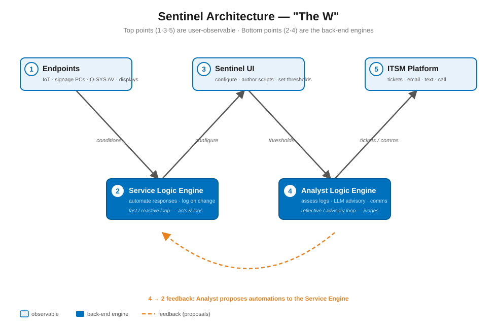

# Sentinel Architecture Vision — "The W"

> **Status:** north-star reference. This is the target architecture for **all** Sentinel work.
> Every new feature, refactor, or phase plan should state which point(s) of the W it serves
> and must not violate the separation of concerns described here. Transport details live in the
> companion [Sentinel MQTT Architecture](./sentinel-mqtt-architecture.md); this document is the
> functional/conceptual map that sits above it.

---

## 1. The model



Sentinel is a monitoring, automation, and service platform shaped like the letter **W**: five
points, three on top and two on the bottom.

- The **three top points (1, 3, 5)** are **end-user-observable** — the things people see and touch.
- The **two bottom points (2, 4)** are the **back-end engines** that connect them and do the work.

The strokes of the W are the flow of information: a condition observed at an endpoint travels
**down** into the engines, is acted on and logged, is assessed, and surfaces back **up** as a UI
state, a ticket, or a notification.

```
   (1) ENDPOINTS          (3) SENTINEL UI            (5) ITSM PLATFORM
   IoT / signage PCs      configure + author          tickets / email /
   Q-SYS AV / displays    scripts + thresholds         text / call
        \                  /          \                   /
         \                /            \                 /
          \              /              \               /
           \            /                \             /
        (2) SERVICE LOGIC ENGINE      (4) ANALYST LOGIC ENGINE
        automate responses +          assess logged data, LLM advisory,
        log conditions/actions        and outbound communication
        ── fast / reactive loop ──    ── reflective / advisory loop ──
```

Read the strokes left-to-right: **1 → 2 → 3 → 4 → 5**.
- **1→2** endpoints emit conditions to the Service Logic Engine.
- **2→3** the engine's behavior is configured/authored in the UI (and the UI reads its logs/state).
- **3→4** thresholds and policies set in the UI drive the Analyst Logic Engine.
- **4→5** the Analyst Logic Engine opens tickets / sends notifications to the ITSM platform.
- **4→2** (the feedback arc) the Analyst Logic Engine can propose automations back to the Service
  Logic Engine — the loop that lets Sentinel get smarter over time.

---

## 2. The five points

### Point 1 — Endpoints *(observable)*
The devices people actually see: IoT devices, Windows PC signage players, Q-SYS AV hardware,
displays, BrightSign/LG/WebOS players, etc.

- They emit telemetry/state and receive commands.
- Reached via the transport layer: the **edge agent** (`DXSuite.SentinelGateway`) over MQTT for
  LAN devices and script execution, cloud-platform connectors (Engage/Ink/Q-SYS Reflect) for
  cloud-managed fleets, and direct probes (TCP/ICMP/HTTP) where applicable.
- An endpoint may also *be* an agent host (a Windows/Linux box running the agent that both reports
  on itself and runs Tasks) — see the agent-generalization roadmap item.

### Point 2 — Service Logic Engine *(back-end; fast/reactive loop)*
The real-time control loop. Two jobs:

1. **Automate responses** to device/environment conditions — reboot a device, clear a cache, run a
   remediation — based on automation logic assigned to the device or environment. That logic is
   authored by engineers using the **Tasks** (scripting) feature.
2. **Log on change** — record conditions when they change, which automations ran, and any
   subsequent change that resulted. This log is the raw material Point 4 reasons over.

The Service Logic Engine is deterministic and quick. It does not decide *whether a human should be
told* — it acts, and it records.

### Point 3 — Sentinel UI *(observable)*
Where Sentinel is configured. Authoring Tasks (scripts), setting automation-triggering thresholds,
defining device models/descriptors, managing gateways, ITSM connections, LLM providers, and
guardrail policies. It is also where the logged state and execution history surface for humans.

### Point 4 — Analyst Logic Engine *(back-end; reflective/advisory loop)*
The slower, reflective loop that consumes what Point 2 logged. Two jobs:

1. **Assess** logged data and decide how to handle it.
   - *Basic:* apply the rules configured in the UI.
   - *Advanced:* use an **LLM cloud connector** to review the state of a device or environment, and
     potentially **propose a new automation back to the Service Logic Engine** to try under certain
     conditions (the 4→2 feedback arc).
2. **Communicate** — create tickets in an ITSM platform, or send an email/text/call to a specific
   person.

### Point 5 — ITSM Platform *(observable)*
Where the operators of an environment ultimately manage it: Jira Service Management, ServiceNow, or
a generic REST endpoint. Sentinel creates/updates/auto-resolves tickets here; it does not own the
operator's workflow, it feeds it.

---

## 3. The two loops (why there are two engines, not one)

The bottom of the W is split deliberately:

| | Point 2 — Service Logic | Point 4 — Analyst Logic |
|---|---|---|
| **Tempo** | Fast, per-cycle, reactive | Slower, reflective, batch/triggered |
| **Decides** | *What to do right now* | *What it means and who to tell* |
| **Inputs** | Live telemetry, thresholds | The Service Logic Engine's logs |
| **Outputs** | Device commands, Tasks, log entries | Tickets, notifications, proposed automations |
| **Determinism** | Deterministic playbooks | Rules → optional LLM judgment |
| **Failure mode** | Try the fix, log the result | Escalate to a human via ITSM/comms |

Keeping them separate means the fast path never blocks on an LLM call or a ticket round-trip, and
the analytical path has a clean, durable record to reason over.

### The 4→2 feedback arc — design decision

The "getting smarter" capability — observing what happened and proposing a *new* automation to try
next time — lives in the **Analyst Logic Engine (Point 4)**, not the Service Logic Engine.

This was a deliberate change of direction. The original intent was to host that intelligence inside
the Service Logic Engine, so the engine that acts would also be the one that learns. On reflection,
keeping it in Point 4 is the better fit: **analysis belongs to the module built for analysis.** It
preserves the two-loop split — the Service Engine stays a deterministic executor that acts and logs,
while all judgment (rules, LLM assessment, and now proposing automations) is concentrated in one
place where the durable log already lives and where the LLM connector and comms already are.

Consequences that the implementation must honor:

- **The arc carries *proposals*, not commands.** The Analyst Engine emits a candidate automation
  (a Task or playbook + the conditions under which to try it); the Service Engine remains the only
  component that executes. Point 4 never reaches around Point 2 to act on a device directly.
- **Proposals are reviewable and governed.** A proposed automation enters as a draft/suggested
  state — subject to the same guardrails, approval, and dry-run gates as any other automation, and
  attributable to its analytical source (rule vs. LLM) in the audit trail.
- **The loop is closed by the existing machinery.** Adoption flows back through the normal
  automation authoring/versioning path (`AutomationDefinition`/`AutomationVersion`); a trialed
  proposal's outcome is logged by Point 2 like any other automation, which Point 4 then re-assesses.

---

## 4. Mapping to the current codebase

The W is largely realized already; the table maps each point to the components that implement it
and their state. (Verify names against current code before citing — this is a point-in-time map.)

| W point | Implemented by | State |
|---|---|---|
| **1 Endpoints** | `DXSuite.SentinelGateway` (edge agent, MQTT), cloud connectors (Engage/Ink/Q-SYS Reflect), probe drivers (`Services/Drivers`) | Agent + MQTT transport built and round-trip-verified; cloud connectors live |
| **2 Service Logic** | `ServiceTechEngine` (cycle) → `DeviceEvaluator` (ASSESS→CLASSIFY→ACT→LOG→NOTIFY); `AutomationExecutor` + `AutomationContext` + `GuardrailService`; **Tasks** (`SentinelTask*`, `TaskExecutionService`, `SentinelTaskSchedulerService`, reactive `run-script` step); `CommandRouter` | Pipeline wired; Tasks feature-complete (on-demand + scheduled + reactive) except agent generalization |
| **3 Sentinel UI** | Config tabs: Gateways, Device Models, Probe Profiles, **Tasks**, ITSM, LLM Providers, Guardrail Policies; Sentinel dashboard | Tasks authoring/run/schedule/history UI built; other tabs live |
| **4 Analyst Logic** | `ReporterEngine` → `IReportProcessor`; `ILlmGateway` (LLM assessment/advisory); ITSM ticketing via `ItsmAdapterFactory` / `IItsmConnectionProvider` | Reporter + ITSM wired; LLM advisory present; **4→2 proposal arc is confirmed design (see §3), not yet built** |
| **5 ITSM** | `JiraServiceMgmtAdapter`, `RestGenericAdapter`, JSM Service Desk wizard | Ticket create/dedup/auto-resolve working |

**Transport substrate (under all five points):** the MQTT control plane — `MqttConnectionService`,
`ISentinelMessageBus`, `MqttGatewayConnectionManager`, the `DXSuite.Sentinel.Contracts` wire types,
and per-tenant topic/ACL scoping. See the MQTT architecture doc.

---

## 5. What this means for future work (build-toward checklist)

Any future Sentinel effort should be expressible as "this advances point N" (or "this strengthens
the 1→2 / 4→2 / 4→5 stroke"). Known gaps against the target, roughly in priority order:

1. **Agent generalization (Point 1 ↔ 2).** One agent app with composable roles
   (self-monitor/telemetry-emit, tasks, gateway); device-cmd topic subscription; bulk unattended
   enroll for fleets of Windows/Linux hosts that aren't gateways. *Lets Tasks and telemetry reach
   machines that aren't site gateways.*
2. **The 4→2 feedback arc (Analyst → Service).** Build the proposal pipeline described in §3: the
   Analyst Logic Engine emits a candidate automation (Task/playbook + trigger conditions) as a
   reviewable draft; adoption flows through the normal `AutomationDefinition`/`AutomationVersion`
   authoring path under existing guardrails/approval/dry-run. *This is the "gets smarter over time"
   capability and is the biggest missing piece — confirmed design, not yet built.*
3. **DirectorClient telemetry (Point 1).** MQTT telemetry from `DirectorClient_SignageOS` players
   (paused on the ES5/MQTT-library decision).
4. **Comms breadth (Point 4 → 5).** Beyond ITSM tickets: email/SMS/voice notification channels.
5. **Security hardening (cross-cutting, load-bearing for Points 1/2).** Per-tenant broker
   mTLS/ACLs, least-privilege execution accounts for Tasks, script approval/dry-run/audit.

---

## 6. Invariants (do not violate)

- **Point 2 acts and logs; Point 4 judges and communicates.** Don't put LLM calls or ticket
  creation in the fast loop, and don't let the analytical loop execute device commands directly —
  it proposes; the Service Logic Engine acts.
- **The UI (3) configures the engines; it is not a third engine.** Business logic lives in 2 and 4.
- **All execution is tenant-scoped.** Multi-tenant isolation (broker ACLs, per-tenant connection
  strings) is a boundary, not a feature toggle.
- **Tasks are remote code execution.** Integrity (hash-verify), authorization (guardrails +
  approval), least privilege, and audit are mandatory, not optional.
- **Transport is swappable; the protocol is the portability layer.** Code to the seams
  (`ISentinelMessageBus`, `IGatewayConnectionManager`), not to a specific broker product.
