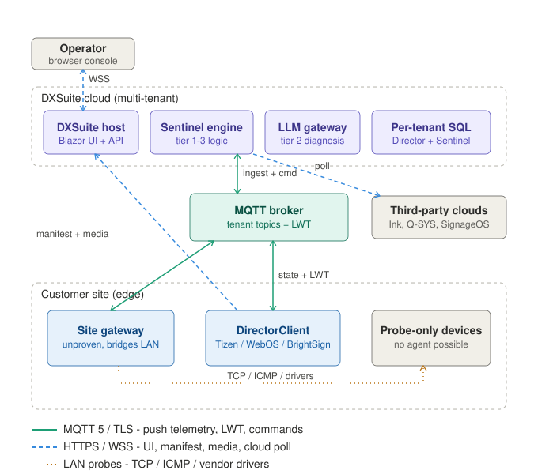

# Sentinel MQTT Architecture

Status: proposal / design (not yet implemented)
Owner: Sentinel
Last updated: 2026-06-17

## 1. Purpose and scope

This document describes a target ("ideal") architecture for the Sentinel monitoring
platform that introduces MQTT as the transport for the **device and gateway control
plane**, and defines the optimal communication method for every link between servers
and endpoints.

It is scoped to *how Sentinel acquires telemetry from and issues commands to
endpoints*. It does not change content delivery, the multi-tenant model, or the
three-tier logic engine — those are referenced only where MQTT touches them.

The guiding principle: **MQTT is a control/telemetry bus, not a file transport, and
not a substitute for polling SaaS you do not own.** It is introduced only where it
removes work Sentinel currently hand-rolls (the gateway WebSocket) or where push +
Last Will & Testament (LWT) materially beats polling (offline detection).

## 2. Target architecture



Node colours: purple = cloud logic plane, teal = the MQTT messaging hub, blue =
endpoints DXSuite controls, grey = systems DXSuite does not control (third-party
SaaS, probe-only devices, the operator browser).

## 3. Where MQTT fits, and where it does not

| Link | Direction | Transport | Why |
| --- | --- | --- | --- |
| DirectorClient player ↔ broker | both | **MQTT 5 / TLS** | Persistent session replaces 30s polling. Push state/health/input on change; subscribe to a command topic; register an LWT for second-scale offline detection. |
| DirectorClient player → host | player-initiated | **HTTPS** | Asset manifest and media. Bulk binary must not traverse MQTT. |
| Site gateway ↔ broker | both | **MQTT 5 / TLS (outbound)** | One outbound TLS connection from the site — NAT/firewall friendly. Replaces the bespoke `/ws/gateway` WebSocket. Publishes telemetry on behalf of probe-only devices; relays commands to them. |
| Site gateway → probe-only device | gateway-initiated | **LAN native (TCP / ICMP / vendor driver)** | Dumb devices (LG, Q-SYS cores, projectors) cannot run an MQTT client. The gateway probes them locally and is their bridge onto MQTT. Never crosses the WAN. |
| Sentinel engine ↔ broker | both | **MQTT** | Ingestion subscriber feeds telemetry/LWT into the evaluation pipeline; `CommandRouter` publishes remediation commands back down. |
| Sentinel engine → third-party cloud | cloud-initiated | **HTTPS REST (poll)** | Ink, Q-SYS Reflect, SignageOS cloud are SaaS DXSuite does not own; their devices cannot speak MQTT. `CloudConnectorSyncService` keeps polling. |
| Operator browser ↔ host | both | **HTTPS / WSS (Blazor SignalR)** | Standard Blazor Server interactive UI. Unchanged. |
| Sentinel engine ↔ SQL | both | **TDS (in-process EF Core)** | Per-tenant `SentinelDBContext`. Unchanged. |

### 3.1 Why not MQTT for DirectorClient content control

Tempting, but a poor fit, for three reasons:

1. **Payload size.** The DirectorClient caches up to ~2 GB of media. MQTT brokers are
   tuned for many small messages, not multi-megabyte blobs; large MQTT payloads cause
   head-of-line blocking, broker memory pressure, and defeat CDN/range-request
   caching. Media stays on HTTPS.
2. **Semantics.** Fetching "the current manifest for this device/location" is a
   request/response with a cacheable, versioned result — exactly HTTP's strength. MQTT
   request/response (MQTT 5 response topics + correlation data) is possible but adds
   ceremony for no gain here.
3. **Offline model.** The client already has robust offline resilience (IndexedDB
   cache, fallback to last-known manifest). HTTP polling degrades gracefully to that;
   there is no availability benefit to moving manifest fetch onto MQTT.

What MQTT *does* add for the DirectorClient is the **control channel alongside**
HTTP content: instant offline detection (LWT), push of health/input state, and
low-latency commands (reboot, screenshot-now, force content refresh). Content
delivery and content control are deliberately separated transports.

## 4. Topic schema

Tenant isolation is the first-class concern — the messaging-plane equivalent of how
`ITenantContext` isolates databases today. Every topic is namespaced by tenant, and
the broker enforces it with ACLs (see section 5).

```
sentinel/{tenantId}/dev/{deviceId}/state      # device -> cloud, retained, QoS 1
sentinel/{tenantId}/dev/{deviceId}/health      # device -> cloud, QoS 1
sentinel/{tenantId}/dev/{deviceId}/lwt         # broker -> cloud on disconnect, retained
sentinel/{tenantId}/dev/{deviceId}/cmd         # cloud -> device, QoS 1
sentinel/{tenantId}/dev/{deviceId}/cmd/ack     # device -> cloud, QoS 1

sentinel/{tenantId}/gw/{gatewayId}/state       # gateway health/heartbeat
sentinel/{tenantId}/gw/{gatewayId}/probe       # gateway -> cloud probe results
sentinel/{tenantId}/gw/{gatewayId}/cmd         # cloud -> gateway (probe requests, relays)
```

Conventions:

- **Retained** `state` and `lwt` so a freshly subscribed ingestion replica gets the
  last-known value without waiting for the next publish.
- **QoS 1** (at-least-once) for telemetry and commands; consumers must be idempotent
  (key on `deviceId` + monotonic sequence/timestamp in the payload).
- `{deviceId}` is the Sentinel `DeviceInstance` identifier so ingestion maps directly
  to the existing entity. Gateway-bridged dumb devices publish under the same
  `dev/{deviceId}` space, with the gateway as the actual MQTT client.

## 5. Authentication and ACL model

- **Authentication:** per-device credentials or, preferably, **mTLS client
  certificates**. No shared keys. This aligns with the planned move to Azure Key
  Vault / managed identity. The existing `GatewayApiKeyHelper` (SHA-256 hashed keys)
  is a reasonable bootstrap for gateways before mTLS lands.
- **Authorisation (topic ACL):** a credential is bound to exactly one `{tenantId}`
  and may only publish/subscribe under `sentinel/{tenantId}/...`. A device may further
  be restricted to its own `{deviceId}` subtree. Cross-tenant subscription must be
  impossible at the broker, independent of application code.
- **Cloud consumers** (the ingestion subscriber, `CommandRouter`) authenticate as
  service principals with broader, tenant-scoped subscribe/publish rights.

## 6. Offline detection flow (LWT → ServiceTechEngine)

This is the headline behavioural change: outage detection drops from minutes
(poll cadence + "heartbeat stale > 2 min") to seconds (keep-alive interval).

1. On connect, each device/gateway registers an LWT message targeting
   `sentinel/{tenantId}/dev/{deviceId}/lwt` (retained).
2. The broker tracks keep-alive. On ungraceful disconnect (power loss, network drop)
   it publishes the LWT after the keep-alive lapses (target: 30–60s, tunable).
3. The ingestion subscriber receives the LWT and marks the `DeviceInstance` offline
   in the Sentinel DB, stamping the source as broker-LWT.
4. `ServiceTechEngine` / `DeviceEvaluator` reacts on the next cycle (or immediately, if
   ingestion raises an evaluation trigger) — classifying the outage and running the
   tiered remediation/notify path exactly as it does for poll-detected outages today.
5. On reconnect, the device republishes `state` (retained), clearing the offline mark.

The evaluation pipeline therefore becomes **event-driven** rather than bound to the
60s tick, while the existing tier 1–3 logic is unchanged.

## 7. Broker options (spike before committing)

| Option | Pros | Cons / watch-outs |
| --- | --- | --- |
| **EMQX / HiveMQ (self-hosted)** | Full MQTT 5, rich ACL + per-client auth, clustering, good observability | You own HA, scaling, patching, and the cert/ACL plumbing |
| **Mosquitto (self-hosted)** | Lightweight, simple, well understood | Single-node by default; clustering/HA is DIY; thinner ACL/auth story at scale |
| **Azure Event Grid namespaces (MQTT)** | Managed, MQTT 5 pub/sub, integrates with Azure identity; fits the planned Azure direction | Topic/ACL design is constrained to the service model; **Azure IoT Hub is *not* general pub/sub — do not assume it** |

Recommendation: run a time-boxed spike against **one self-hosted (EMQX)** and the
**Azure Event Grid MQTT broker**, evaluating specifically: per-tenant ACL
expressiveness, mTLS onboarding, LWT timing accuracy, and cost at projected device
counts. Decide after the spike; do not pre-commit.

## 8. Migration path

MQTT is introduced incrementally; nothing is rebuilt wholesale and the existing poll
path remains the fallback until each stage is proven.

1. **Stand up a broker (non-prod)** with tenant ACLs and mTLS for one pilot tenant.
   Wire an ingestion subscriber that writes telemetry/LWT into the Sentinel DB
   alongside the existing poll-fed data.
2. **Gateway on MQTT first.** Re-target the (currently unproven) `SiteGateway` from
   the bespoke `/ws/gateway` WebSocket to MQTT. This is the highest-value, lowest-risk
   start: it is greenfield in production, and MQTT gives it a proven transport. Prove
   probe relay and command relay end-to-end here.
3. **LWT-based offline detection.** Once the gateway and a handful of pilot devices
   publish LWT, switch offline classification to prefer broker-LWT, keeping the
   stale-heartbeat rule as a backstop.
4. **DirectorClient dual-path.** Add an MQTT client to the SignageOS applet that
   publishes state/health/input and subscribes to `cmd`, while **keeping HTTP for
   manifest + media**. Run MQTT telemetry in parallel with the 30s poll; compare.
5. **Retire redundant polling.** Once MQTT telemetry is trusted for a device class,
   reduce the HTTP sync to manifest/media only (drop the telemetry payload from the
   poll, or lengthen its interval). Cloud-connector polling of third-party SaaS is
   never retired — it has no MQTT equivalent.

## 9. Open questions and risks

- **Gateway is unproven.** The `SiteGateway` has not been deployed or tested. It is
  load-bearing in this design (it is the only path for probe-only devices). Stage 2
  must validate it before later stages depend on it.
- **Broker operational ownership.** Self-hosted brokers add HA/scaling/patching
  burden; a managed broker constrains topic/ACL design. Section 7 spike must settle
  this.
- **Connector decoupling.** `CloudConnectorSyncService` currently reaches directly
  into Director entities (`IDirectorDBContext`). MQTT ingestion should write through a
  provider abstraction (`IDeviceDataProvider`) rather than deepening that coupling —
  track alongside the existing decoupling TODOs.
- **Schema drift.** The live `RIA_Sentinel` DB already carries LLM and connector
  tables not present in `db/provisioning/sentinel-provisioning.sql`; reconcile the
  provisioning baseline before adding any MQTT-related schema.
- **Per-tenant worker iteration.** Background services currently fall back to
  top-level config outside an HTTP scope (see `Extensions.AddSentinelModule`). A
  tenant-aware ingestion subscriber needs the deferred per-tenant worker iteration
  ("Phase 5") to fan out across tenants cleanly.
